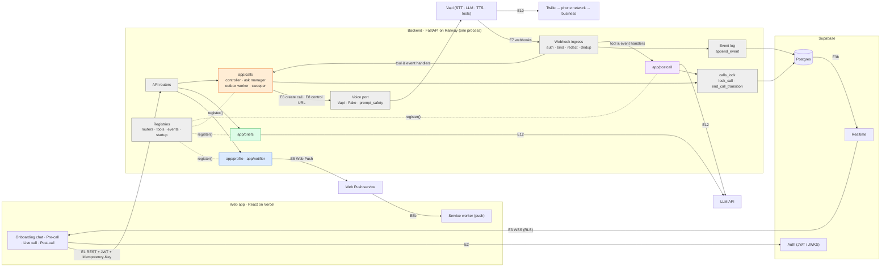
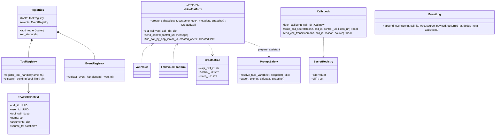
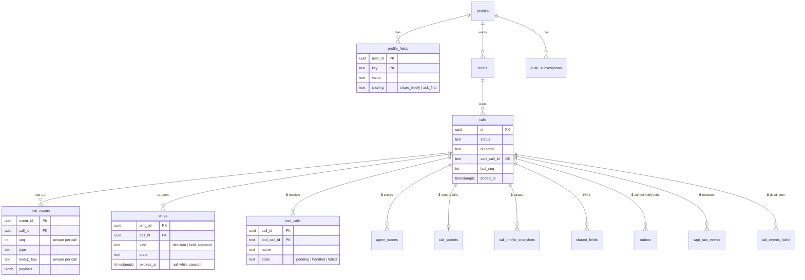
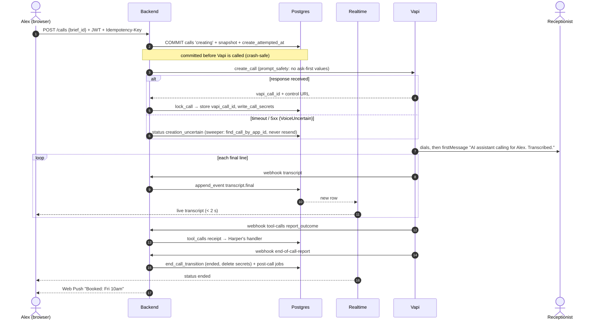
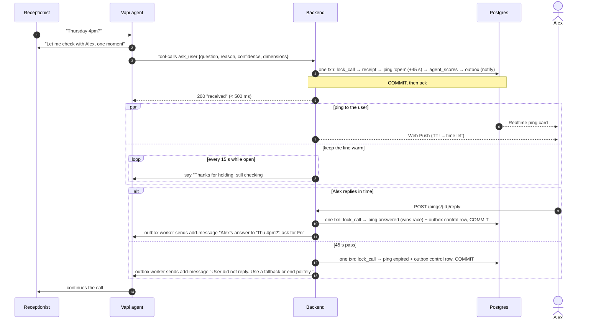
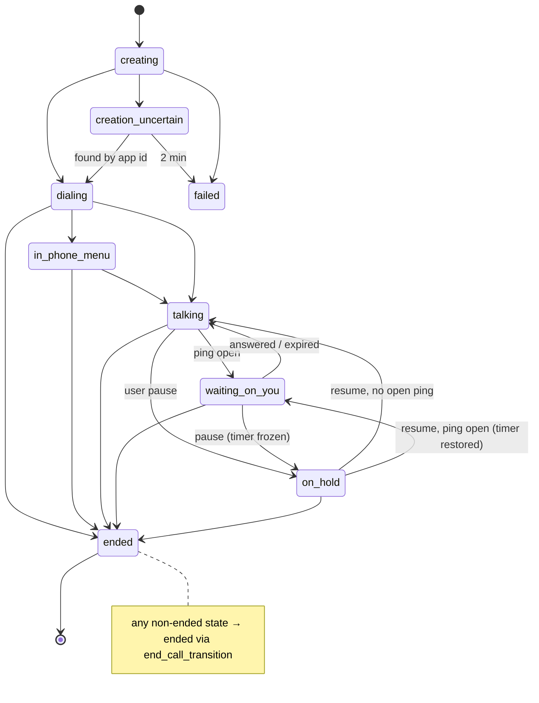
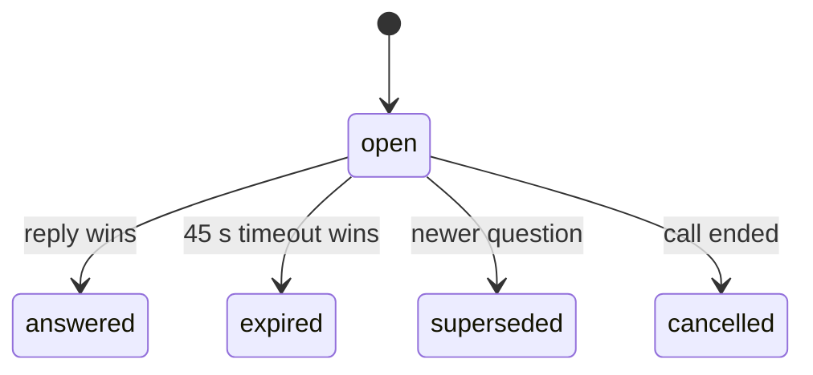
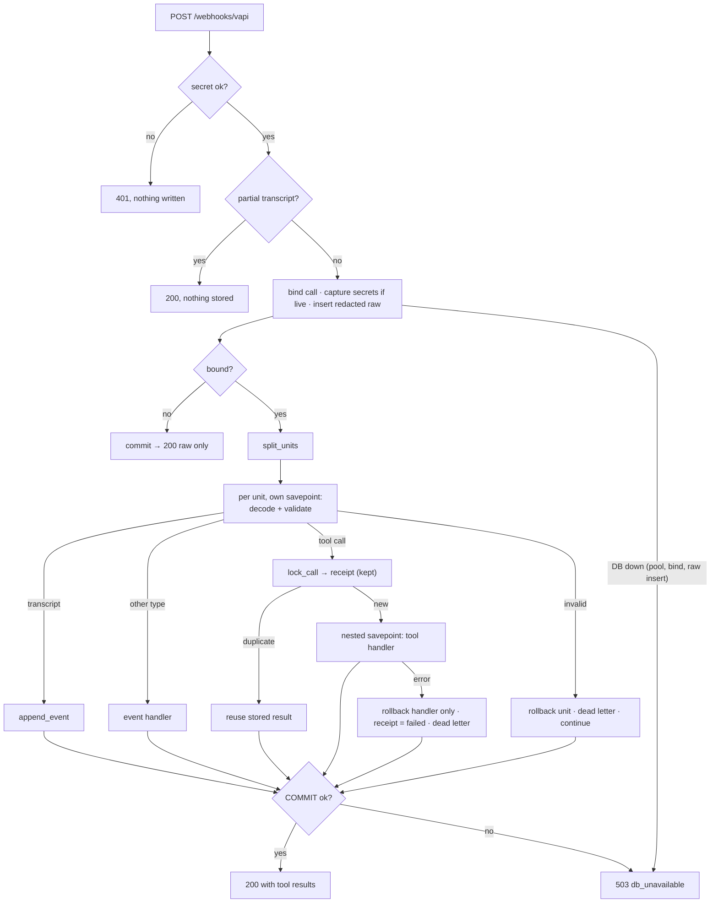

# Architecture Foundation Implementation Plan

> **For agentic workers:** REQUIRED SUB-SKILL: Use superpowers:subagent-driven-development (recommended) or superpowers:executing-plans to implement this plan task-by-task. Steps use checkbox (`- [ ]`) syntax for tracking.

## Context

**Where the project stands (fetched 2026-11-07; local `docs/architecture` is 2 commits behind and already merged):**
- **Merged on `main`:**
  - the blueprint (#6), the PRD snapshot (#5, refreshed in #16) and the Vapi probe kit (#4, Python, stdlib only)
  - an empty React 19 + Vite + TS frontend on Vercel (#7), plus Harper's clickable prototype (#10)
  - Coco's During-call tech doc (#17, `docs/tech-doc-during-call.md`)
  - the chat-onboarding split (#18)
- **Notion PRD now names an owner for each section:**
  - **Onboarding (ON-3, ON-5–ON-8): Steve.** That's you; Notion writes Hung Lin as "Steve".
  - Pre-call (PC-*): Lotto
  - During call (DC-*): Coco
  - Post-call (PO-*): Harper
- **Onboarding changes:**
  - ON-3 adds a required **calling name**.
  - ON-5 says the calling name can never be Ask me first.
  - ON-8 makes onboarding a one-time chat that leads to the chat home.
- **Coco's tech doc, Part 5, is waiting on Steve.** Q7 asks for the backend language and framework; hosting is Railway, set up by Coco. You chose **Python + FastAPI**.
- **Nothing to build on yet:** `backend/` has no code, and `supabase/migrations/` is empty.
- **Build week starts Mon Nov 9.**

**Why this plan:** four people start their sections on Monday. Each section needs the same shared pieces: schema, contracts, auth, the event log, webhook ingress and a voice adapter. If each person builds their own copy, those copies conflict. This plan builds the shared pieces once, so each owner adds only their section's features on top.

**Out of scope, owned by the section owners:**
- Coco: the ask manager, outbox worker, control lane, sweeper, the status state machine and speech handling.
- Lotto: the brief builder and templates.
- Harper: the post-call processor.
- Steve, in a later plan: profile endpoints, the Notifier and the onboarding chat.
- Any frontend screens.

The foundation gives each owner hooks to build on and doesn't fill them.

---

**Goal:** a deployable FastAPI backend, shared JSON Schema contracts with generated types, and the core Supabase schema with RLS. Teammates can extend all three in parallel and test without live Vapi calls.

**Architecture:**
- One FastAPI service, following `docs/architecture.md`.
- **Event log:** Postgres `call_events`, with a gap-free `seq` per call in arrival order.
- **Voice platform:** Vapi sits behind a `VoicePlatform` port, with a real adapter and a fake one.
- **Webhook ingress:**
  - Authenticates, binds the request to a call, redacts and logs the raw delivery, and acks.
  - Deduplicates tool calls into a `tool_calls` table, then dispatches each one to a typed handler registry.
  - Dispatches non-tool events to an event-handler registry.
  - The section owners fill both registries.

**Tech Stack:**
- Python 3.12 with `uv`, FastAPI, uvicorn, pydantic v2, pydantic-settings, `psycopg[binary,pool]` 3 (plain SQL), httpx, PyJWT[crypto]
- Tests and checks: pytest, ruff, mypy --strict, jsonschema (with FormatChecker)
- Type generation: datamodel-code-generator, plus `json-schema-to-typescript` as a frontend dev dependency
- Supabase CLI 2.122.0, with pgTAP via `supabase test db`

**Spec:** `docs/architecture.md` (§1, §3, §4.0–4.3, §5.2–5.3), `docs/tech-doc-during-call.md` and `docs/requirements.md`. Copy this plan to `docs/superpowers/plans/2026-11-07-architecture-foundation.md` in Task 0.

## Global Constraints

- **JSON:**
  - UTF-8 JSON on every edge.
  - Times are ISO 8601 UTC with milliseconds; phones are E.164; IDs are UUIDs, except Vapi IDs, which are opaque strings.
  - Contracts are JSON Schema draft 2020-12 in `contracts/`. Types are generated, never written by hand.
- **Schema evolution:**
  - Additive changes only.
  - Readers ignore unknown fields. Enums marked `"x-open-enum": true` (event type, call status, outcome, ping state) are open for readers: generated TS adds `| (string & {})`, and the UI shows "Unknown".
  - Writers (the backend) validate against the closed enum before storing.
  - Every event carries `schema_version: 1`.
- **Errors:**
  - Every error, including FastAPI's request-validation errors, uses `{ "error": { "code", "message", "retryable" } }`.
  - Mutating requests carry an `Idempotency-Key: <uuid>` header and `Authorization: Bearer <Supabase JWT>`.
- **Database:**
  - Every `public` table enables RLS in the migration that creates it, and the browser reads only its own rows.
  - Calls, call_events, pings, shared_fields, tool_calls and the outbox are written only by the backend.
  - Backend-only tables have RLS on, no policies and no browser grants: `vapi_raw_events`, `call_events_failed`, `tool_calls`, `agent_scores`, `call_secrets`, `call_profile_snapshots`, `outbox` and `idempotency_keys`.
  - The backend connects with the Postgres connection string through the Supabase session pooler. It never uses the service-role API key.
- **Scores never reach the browser (DC-5):**
  - `confidence` and `dimensions` are stored only in `agent_scores`.
  - Browser-readable payloads are built from explicit allow-lists.
- **Vapi:**
  - Assistant configs must set `artifactPlan.recordingEnabled: false` and `artifactPlan.transcriptPlan.enabled: true`. The adapter refuses any other config.
  - Capability URLs (`monitor.controlUrl`, `monitor.listenUrl`) live only in `call_secrets`.
  - Every stored or logged copy of a Vapi body is scrubbed (see `redact`). Raw bodies are never logged.
  - Webhook ack budget is 500 ms. No LLM, push or control-URL call happens inline in the webhook.
  - The adapter never retries. It reports `VoiceNotSent` (provably never sent) or `VoiceUncertain` (sent; timeout or 5xx), and callers decide what to do.
- **Calling name:** profile field key `calling_name`, always `share_freely` (ON-3, ON-5).
- **Lock order:** any transaction that touches a call's `pings`, `call_secrets`, `outbox` or `call_events` calls `lock_call(conn, call_id)` first. That means the `calls` row first, then the ping and the other rows. `append_event`'s `last_seq` update re-locks the same row, so it doesn't add a second lock. This rule binds every owner, and the backend README states it.
- **Repo rules:**
  - Conventional Commits with scopes backend, frontend, db, ci, docs.
  - `make check` and `make db-check` pass before each push.
  - Fake data only ("Alex Chen", 555 numbers).
  - Commit trailer: `Co-Authored-By: Claude Opus 5.5 <noreply@anthropic.com>`.

## Review Focus

1. **Vapi delivers the same webhook twice, or out of order.** One canonical event and one `tool_calls` row result. A tool handler runs once; a repeat delivery returns the stored result. `seq` stays gap-free. Owner: Task 5 and Task 7.
2. **A webhook arrives with a missing or wrong secret, or for an unknown or mismatched call.** A bad secret gets a 401 and nothing is written. An unknown call is raw-logged, writes no canonical event, and gets a 200. Owner: Task 7.
3. **A body carries `monitor.controlUrl`, a token-bearing URL or an echoed secret header.** It never appears in raw rows, canonical events, `call_events_failed` or the logs. Owner: Task 7.
4. **User A's real Supabase session reads user B's rows, or reads any score.** It gets zero rows, `agent.decision` payloads carry no `confidence` or `dimensions`, and writes to backend-only tables are denied. Owner: Task 3 and Task 7.
5. **An unknown event type or status, a SQL error mid-processing, or `calling_name` set to `ask_first`.** Unknown inputs are raw-logged and acked. A SQL error leaves a `call_events_failed` row and still acks. Persistence down returns 503. The database rejects the `ask_first` update. Owner: Task 7 and Task 3.

---

### Task 0: Sync and branch

- [ ] `git checkout main && git pull --ff-only`. Leave the merged local `docs/architecture` branch alone.
- [ ] `git checkout -b feat/backend-foundation`, then copy this plan to `docs/superpowers/plans/2026-11-07-architecture-foundation.md`.
- [ ] Run `make check`, which should be green, as the baseline.

### Task 1: Backend skeleton, tooling, CORS and CI

**Files:**
- Create:
  - `backend/pyproject.toml` and `backend/uv.lock`
  - `backend/Makefile`
  - `backend/app/{__init__,main,config,errors}.py`
  - `backend/tests/test_app.py`
  - `backend/.env.example`
  - `backend/railway.toml`
- Modify:
  - Root `Makefile`: `SUBPROJECTS := contracts backend frontend spikes/vapi`
  - `.github/workflows/ci.yml`:
    - **build job:** `astral-sh/setup-uv`, Python 3.12, `uv sync --project backend --frozen`
    - **changes filter:** `backend/**` and `contracts/**` also trigger the database job
    - Each later CI step lands in the task that makes it pass, so every commit stays green:
      - **Task 4** adds to the database job: start the full local stack with `supabase start -x studio,imgproxy,inbucket,edge-runtime,logflare,vector` (`db-check` only starts Postgres), set up uv, and run `make -C backend test-db`.
      - **Task 8** adds Node, `npm ci --prefix frontend` and `make -C backend realtime-smoke`.
  - `.pre-commit-config.yaml` (ruff)
  - `.github/dependabot.yml` (uv for `/backend`)

**Interfaces (Produces):**
- `create_app(settings: Settings | None = None) -> FastAPI`
- `Settings`, with these fields:
  - `database_url`: Postgres password URL through the session pooler
  - `supabase_url`, plus `supabase_jwt_issuer` (default `{supabase_url}/auth/v1`) and `supabase_jwks_url` (default `{supabase_url}/auth/v1/.well-known/jwks.json`)
  - `supabase_jwt_secret: SecretStr | None`, the legacy HS256 fallback
  - `cors_origins: list[str]`, plus `cors_origin_regex: str | None` for Vercel previews
  - `vapi_api_key`, `vapi_webhook_secret` and `vapi_phone_number_id`
  - `vapi_ip_allowlist: bool = False`
  - `voice_platform: Literal["vapi","fake"] = "fake"`
- `class ApiError(Exception)`, with `code`, `status`, `message` and `retryable`. Four handlers render errors in the shared shape:
  - `ApiError`
  - `RequestValidationError` → 422 `invalid_request`, `retryable=false`
  - Starlette `HTTPException` → its own status. 404 becomes `not_found`, 405 becomes `method_not_allowed`, and any other status becomes `http_<status>`.
  - unhandled exceptions → 500 `internal`, `retryable=true`, with no stack trace in the body
- `create_app` loads owner packages at startup:
  - It iterates `pkgutil.iter_modules(app.__path__)`, imports each package, and calls `register(reg: Registries)` on any package that defines it.
  - In this task, `Registries` has `add_router(router: APIRouter)` and `on_startup(fn: Callable[[], Awaitable[None]])`.
  - Task 7 adds `tools` and `events` to it, and registers `dispatch_pending` through `on_startup`.
  - Owners never edit `main.py` to plug in.
- `CORSMiddleware`:
  - allowed methods: `GET, POST, PATCH, DELETE, OPTIONS`
  - allowed headers: `Authorization, Content-Type, Idempotency-Key`
  - no cookies
- `GET /health` → `{"status":"ok"}`

- [ ] Write the tests:
  - `test_health_ok`
  - `test_api_error_shape`
  - `test_validation_error_uses_shape`
  - `test_404_and_405_use_shape`
  - `test_discovered_package_router_is_mounted`: a test package under a temporary `app` path registers `GET /x`, which returns 200
  - `test_unhandled_error_hides_details`
  - `test_cors_preflight_allows_vercel_origin_and_idempotency_header`
  - `test_cors_rejects_unknown_origin`
- [ ] Run `make -C backend test`, and confirm it fails.
- [ ] Implement. `backend/Makefile` targets:
  - `lint` = ruff check, ruff format --check, mypy --strict app
  - `test` = `uv run pytest -m "not db"`
  - `test-db` = `uv run pytest -m db`
  - `build` = `uv run python -c "import app.main"`
- [ ] Add `railway.toml`: start command `uv run uvicorn app.main:app --host 0.0.0.0 --port $PORT`, healthcheck `/health`.
- [ ] Run `make check`, which should pass.
- [ ] Commit `feat(backend): add FastAPI skeleton with error shape, CORS and CI`.

### Task 2: Shared contracts and generated types

**Files:**
- Create in `contracts/`:
  - `call-event.v1.json`: the envelope from blueprint §3, with `type` open (`x-open-enum`).
    - An `allOf` of `if {type: const X} then {payload: $ref payloads/X.v1.json}` pairs ties each known type to its payload.
    - An unknown `type` falls through with `payload: object`, for tolerant readers.
    - Generated TS has two parts:
      - `KnownCallEvent`, a discriminated union over the 8 types with no catch-all member, so `switch (e.type)` narrows the payload.
      - An explicit decoding boundary, `parseCallEvent(raw: unknown): { kind: "known"; event: KnownCallEvent } | { kind: "unknown"; raw: unknown } | { kind: "invalid"; raw: unknown; error: string }`.
        - `gen-ts.mjs` generates it from the schemas, covering only the subset they use: `required`, primitive `type`, nullable, `const`, closed `enum`, and nested objects and arrays.
        - It validates the envelope and the payload for the known type at runtime.
        - Extra fields are allowed, and open-enum values aren't checked against the set.

      The UI renders the `unknown` kind as "Unknown" and drops `invalid` events, with a console warning.
  - `brief.v1.json`: the reviewed brief, which is the handoff from Lotto to Coco. Fields:
    - `goal`, `business_name`, `phone_e164`, `template_key|null`
    - `task_line: string ≤ 120`. It is a template, and its `{name}` placeholders resolve from `task_vars`.
    - `task_vars`: an object whose values are each either `{ "literal": string }` (what the user typed for this call, e.g. party size) or `{ "field_ref": key }` (a profile field, resolved against the snapshot at call start).
    - `constraints[]`, `preferences[]`, `fallbacks[]` (ranked) and `never_agree[]`, each `{text}`
    - `share_freely_keys[]` and `ask_first_keys[]`

    It holds **field keys only, never profile values**. The values come from `call_profile_snapshots` at call start, and only share-freely values reach the prompt. Lotto owns how the brief is built; this fixes only its shape.
  - `payloads/<type>.v1.json`, one per event type, with these browser-visible payloads only:
    - `status.changed`: `{status}`, open enum `creating, creation_uncertain, dialing, in_phone_menu, talking, waiting_on_you, on_hold, ended, failed`
    - `transcript.final`: `{role: agent|business|user, text, source_start_ts: date-time|null}`
    - `ping.opened`: the `ping.v1` object
    - `ping.resolved`: `{ping_id, state, reply_text?}`
    - `agent.decision`: `{situation, action, reason, field_key?}`. Deliberately no `confidence` and no `dimensions`.
    - `field.shared`: `{field_key, state}`
    - `command.applied`: `{command: instruction|pause|resume|end}`
    - `call.ended`: `{outcome|null, ended_reason}`, outcome as an open enum
  - `ping.v1.json`: as in the blueprint, with these changes:
    - `expires_at` is `string(date-time) | null`; it is null while paused.
    - New `remaining_ms: integer | null`.
    - `state` is open.
  - Tool argument schemas, taken from `function.parameters` in blueprint §3, not from the Vapi wrapper:
    - `tools/ask_user.args.v1.json`
    - `tools/report_decision.args.v1.json`
    - `tools/report_outcome.args.v1.json`

    Changes from the blueprint, following the tech doc:
    - `confidence` becomes `high|medium|low`.
    - `ask_user` and `report_decision` gain `dimensions`, an object of 6 required booleans:
      - `needs_ask_first_field`
      - `involves_money`
      - `meets_constraints`
      - `matches_fallback`
      - `answerable_from_brief`
      - `understood`
  - The commands:
    - `commands/create-call.v1.json`: `{brief_id: uuid}`
    - `commands/ping-reply.v1.json`: `oneOf {choice: int 0..3}` or `{text: string 1..200}`
    - `commands/call-command.v1.json`: `{type: instruction|pause|resume|end, text?: string ≤200}`, where `text` is required when `type=instruction`
  - `error.v1.json`: `{error: {code: string, message: string, retryable: boolean}}`, required, with no extra properties at the top level
  - `examples/<schema>.valid.json` and `examples/<schema>.invalid.json` for each schema. Include an `agent.decision` example that carries `confidence` and must fail.
  - `gen-ts.mjs`: runs json-schema-to-typescript, then appends `| (string & {})` to the types of `x-open-enum` properties
  - `Makefile`:
    - `gen` writes three outputs:
      - `backend/app/contracts/generated.py` (datamodel-code-generator, pydantic v2)
      - `frontend/src/contracts/generated.ts`
      - a copy of every schema into `backend/app/contracts/schemas/`, so the Railway build from `backend/` ships them. The backend loads schemas only from that copy, through `importlib.resources`.
    - `lint` has two parts:
      - every schema passes `Draft202012Validator.check_schema`
      - `gen` writes into a temp dir, then `diff -r` compares it to the three checked-in outputs. Missing or extra files fail too, and unrelated working-tree edits are ignored.
    - `test` runs `node contracts/test-parse.mjs`, which imports the generated `parseCallEvent` through a tiny build step with `tsc --outDir` into a temp dir. It checks:
      - each `examples/*.valid.json` event gives `known`
      - `{type:"transcript.final", payload:null}`, a payload missing `text`, and `role:"robot"` (a closed enum) all give `invalid`
      - an unknown type gives `unknown`
      - an extra field and an unknown status value still give `known`
    - `build` is a no-op
- Create `backend/app/voice/tools.py`, with `tool_definitions() -> list[dict]`. It builds Vapi's `{"type":"function","async":true,"function":{name, description, parameters}}` wrappers from the argument schemas, with the descriptions copied from blueprint §3.
- Modify `frontend/package.json` to add `json-schema-to-typescript` to devDependencies.

- [ ] Write `backend/tests/test_contracts.py`:
  - `test_schemas_are_valid_2020_12`
  - `test_examples_validate`, with a `FormatChecker`: each `*.valid.json` passes and each `*.invalid.json` fails
  - `test_call_event_types_match_blueprint`: the set must equal `{"status.changed","transcript.final","ping.opened","ping.resolved","agent.decision","field.shared","command.applied","call.ended"}`
  - `test_agent_decision_payload_rejects_score_fields`
  - `test_tool_definitions_wrap_args_schemas`: the wrapper has `async: true`, and `parameters` equals the args file
  - `test_generated_ts_has_open_enums`: `generated.ts` contains `| (string & {})` for `status`
  - A consumer type check, `frontend/src/contracts/typecheck.ts`, compiled by the existing `tsc -b` in `make check`:
    - narrows `KnownCallEvent` on `type === "transcript.final"` and reads `payload.text`
    - handles `parseCallEvent`'s unknown branch
    - includes a `// @ts-expect-error` line reading `payload.text` from a `status.changed` event
  - `test_envelope_binds_payload_to_type`: a `transcript.final` with a `status.changed` payload fails, and an unknown type with any object payload passes
  - `test_brief_rejects_profile_values`: `additionalProperties: false`, and no value fields
  - `test_schemas_load_from_package`: works with the cwd set to `backend/`
- [ ] Run the tests and confirm they fail. Add the files, then run `make -C contracts gen`.
- [ ] Run `make check`, which should pass, including the drift check through `lint`.
- [ ] Commit `feat(backend): add JSON Schema contracts with generated Python and TS types`.

### Task 3: Core schema migrations with RLS

Create each migration with `supabase migration new`, one per domain. All tables enable RLS.

1. **`profiles` and `profile_fields`:**
   - `profiles`: `id` uuid PK referencing `auth.users`, plus `onboarded_at timestamptz null` (ON-8).
   - `profile_fields`: `user_id`, `key`, `value`, `sharing` with a check in (`share_freely`,`ask_first`), PK (`user_id`,`key`), and `check (key <> 'calling_name' or sharing = 'share_freely')`.
   - Policies: the owner can select, insert and update their own rows.
2. **`briefs`:** `id`, `user_id`, `goal`, `business_name`, `phone_e164`, `template_key null`, `brief jsonb`, `missing_fields jsonb`, `created_at`. Owner select.
3. **Calls and the event log:**
   - `calls`: `id`, `user_id`, `brief_id`, `status text default 'creating'`, `outcome null`, `vapi_call_id unique null`, `create_attempted_at`, `last_seq int not null default 0`, `latest_ask_at null`, `max_duration_s int default 900`, `created_at`, `ended_at`. Owner select.
   - `call_events`:
     - Columns: `event_id`, `call_id`, `seq`, `type`, `source`, `dedup_key null`, `occurred_at`, `received_at default now()`, `schema_version smallint default 1`, `payload jsonb`.
     - Unique (`call_id`,`seq`) and (`call_id`,`dedup_key`). Owner select through `calls`.
     - Add it to the `supabase_realtime` publication.
   - `call_events_failed`: `id`, `call_id null`, `raw_event_id`, `error`, `created_at`. Backend-only.
   - `vapi_raw_events`: `id bigserial`, `call_id null`, `vapi_call_id null`, `message_type`, `body jsonb` (redacted), `received_at`. Backend-only. This is a delivery log: every delivery gets a row, with no dedup.
   - `call_secrets`: `call_id` PK, `control_url`, `listen_url`, `updated_at`. Backend-only. Lifecycle:
     - Every write and the end transition go through two helpers in `backend/app/calls_lock.py`, built in Task 5:
       - `lock_call(conn, call_id) -> CallRow` runs `select … from calls where id=$1 for update`.
       - `write_call_secrets(conn, call_id, control_url, listen_url) -> bool` takes that lock, writes nothing when `ended_at is not null`, and returns whether it wrote.
     - `end_call_transition(conn, call_id, *, reason: str, source: str) -> bool` is the **one shared end transition**. It takes `lock_call` and does nothing if the call has already ended. Otherwise it:
       - sets `status='ended'` and `ended_at=now()`
       - deletes `call_secrets`
       - cancels the call's open ping and its pending `control` outbox rows
       - appends `status.changed {status:"ended"}`
       - returns True

       Whichever event arrives first calls it, in the same transaction as its own work: Coco's `status-update` handler (status `ended`), or Harper's `end-of-call-report` handler, which then enqueues post-call jobs. The function returns False when the call had already ended, which keeps it idempotent. A create response that arrives late, or a webhook that overlaps the end, can't bring a secret back.
4. **Pings and tool calls:**
   - `pings`:
     - Columns: `ping_id`, `call_id`, `kind`, `field_key`, `question`, `reason`, `suggested_replies jsonb`, `state default 'open'`, `expires_at null`, `remaining_ms null`, `vapi_tool_call_id unique`, `source_ts`, `answered_at`.
     - Partial unique index on `pings(call_id) where state='open'`.
     - Owner select, and add it to the realtime publication.
   - `tool_calls`: `call_id`, `tool_call_id`, `name`, `arguments jsonb`, `source_ts null`, `state` in (`pending`,`handled`,`failed`) with default `pending`, `result jsonb null`, `error null`, `created_at`, and PK (`call_id`,`tool_call_id`). Backend-only.
   - `agent_scores`: `call_id`, `tool_call_id`, `tool`, `confidence`, `dimensions jsonb`, and PK (`call_id`,`tool_call_id`). Backend-only.
5. **Snapshots and disclosure:**
   - `call_profile_snapshots`: `call_id`, `key`, `value`, `sharing`. Backend-only.
   - `shared_fields`: `call_id`, `field_key`, `state` in (`approved`,`sent_to_agent`,`spoken`), with timestamps. Owner select.
6. **Outbox, idempotency and push:**
   - `outbox`: `id bigserial`, `call_id`, `lane` in (`control`,`notify`,`jobs`), `kind`, `payload`, `state` in (`pending`,`sent`,`uncertain`,`failed`,`cancelled`), `attempts`, `not_before`, `created_at`, with a partial index on (`lane`,`call_id`,`id`) where `state='pending'`. Backend-only.
   - `idempotency_keys`: `user_id`, `key`, `status_code null`, `response jsonb null`, `created_at`, and PK (`user_id`,`key`). Backend-only.
   - `push_subscriptions`: `user_id`, `endpoint unique`, `p256dh`, `auth`. The owner can select and delete.
7. **Grants:** revoke all on the backend-only tables from `anon` and `authenticated`.

The foundation stores transcript partials nowhere and doesn't broadcast them. If Coco adds Broadcast later, it needs its own `realtime.messages` owner policies and tests.

**Tests and checks:**
- Create `supabase/tests/rls.test.sql` (pgTAP). It sets `role authenticated` and `request.jwt.claims` for Alex and for a second fake user, then asserts:
  - The owner reads their own row on every owner table. This is the positive check, so a policy that denies everything fails.
  - Cross-user selects return 0 rows on every owner table.
  - Inserts into `calls`, `call_events`, `pings`, `shared_fields` and `outbox` are denied.
  - Every backend-only table returns permission denied for `authenticated` and `anon`.
  - The `calling_name`/`ask_first` update is rejected.
  - A second open ping for the same call violates the unique constraint.
- Modify `scripts/check-db.sh` to run `"$SUPABASE_BIN" test db` after the RLS assertion.

- [ ] Write the pgTAP tests, run `make db-check`, and confirm it fails.
- [ ] Add the migrations.
- [ ] Run `make db-check`, which should pass with lint clean.
- [ ] Commit each migration as its own `feat(db): add <domain> tables with RLS`.

### Task 4: DB pool, Supabase auth and idempotency

**Files:**
- Create:
  - `backend/app/db.py`
  - `backend/app/auth.py`
  - `backend/app/idempotency.py`
  - `backend/app/routers/me.py`
  - `backend/tests/conftest.py`: reads `DATABASE_URL` and the local auth URL from `supabase status -o env`, defines the `db` marker, and has a fixture that **signs up a real local Auth user** through `POST {SUPABASE_URL}/auth/v1/signup` and returns its access token
  - `backend/tests/test_auth.py` and `backend/tests/test_idempotency.py`
- Modify `.github/workflows/ci.yml`: the database-job steps listed for Task 4 in Task 1.

**Interfaces (Produces):**
- `get_pool() -> AsyncConnectionPool`, opened in the lifespan.
- `async def current_user(authorization: str | None = Header(default=None)) -> UUID`:
  - It parses `Bearer <token>`.
  - If the token header's `alg` is ES256 or RS256, it verifies with a key from `JwksCache`, a shared async class in `auth.py`:
    - It fetches the JWKS over `httpx.AsyncClient`, so the event loop is never blocked, and caches it for 10 min.
    - On an unknown `kid` it refetches, at most once per 30 s, so key rotation works.
    - Keys are built with `jwt.PyJWK`, with no network call.
  - If the `alg` is HS256 and `supabase_jwt_secret` is set, it verifies with the secret.
  - Any other algorithm is rejected.
  - It requires `exp`, `aud="authenticated"`, `iss == supabase_jwt_issuer` and a UUID `sub`.
  - Errors: 401 `unauthenticated` for a missing header, bad syntax, bad signature, wrong audience or wrong issuer; 401 `token_expired` when it has expired.
- `async def claim_idempotency(conn, user_id: UUID, key: UUID) -> StoredResponse | None`, inside the caller's transaction:
  1. It calls `pg_try_advisory_xact_lock(hashtextextended(user_id::text || key::text, 0))`. If the lock is taken, it raises `ApiError("in_progress",409,...,True)`.
  2. Next it selects the row. If the row has a response, it returns that stored response.
  3. Otherwise it inserts the row and returns `None`.
- `async def store_idempotent_response(conn, user_id, key, status_code, body) -> None`
- Dependency `idempotency_key(header) -> UUID`: 400 `idempotency_key_required` when the header is missing or isn't a UUID.
- `GET /me` → `{user_id, onboarded}`. It is the example auth + DB route, and it creates the `profiles` row if missing.

- [ ] Write the tests:
  - `test_missing_header_401_shape`
  - `test_bad_scheme_401`
  - `test_expired_token_401`
  - `test_wrong_audience_401`
  - `test_wrong_issuer_401`
  - `test_alg_none_rejected`
  - `test_es256_token_verified_via_jwks`: a test keypair and JWKS served through httpx MockTransport
  - `test_unknown_kid_triggers_one_refetch` (key rotation)
  - `test_real_local_supabase_token_accepted` (db)
  - `test_idempotency_replay_returns_stored` (db)
  - `test_idempotency_concurrent_returns_409`: connection A holds the claim in an open transaction while connection B claims and gets 409 immediately (db)
  - `test_missing_idempotency_key_400`
- [ ] Run the tests and confirm they fail. Implement, then confirm `test` and `test-db` pass.
- [ ] Commit `feat(backend): add Supabase JWT auth, DB pool and idempotency keys`.

### Task 5: Event log append

**Files:** create `backend/app/events.py` and `backend/tests/test_events.py`.

**Interfaces (Produces):** `async def append_event(conn, *, call_id: UUID, type: str, source: Literal["vapi","backend","user"], payload: dict, occurred_at: datetime, dedup_key: str | None = None) -> CallEvent | None`. It runs inside the caller's transaction:
1. It validates `payload` against `contracts/payloads/<type>.v1.json`, using the closed writer enums. On a mismatch it raises `ContractError`.
2. Inside a savepoint, it updates `calls set last_seq = last_seq + 1 ... returning last_seq`. That row lock serialises `seq` per call.
3. Then it inserts with `on conflict (call_id, dedup_key) do nothing`.
4. On a conflict, it rolls back the savepoint, which releases the burned `seq`, and returns `None`.

**Ordering:** `seq` is arrival order, for replay and gap detection. Transcript order for display is `payload.source_start_ts`, falling back to `occurred_at` (the time it was received) when Vapi doesn't send one.

Also in this task, add `backend/app/calls_lock.py` with `lock_call`, `write_call_secrets` and `end_call_transition` (contracts in Task 3).

- [ ] Write the tests (db):
  - `test_secrets_write_after_end_is_refused`: connection A locks and ends the call while connection B's `write_call_secrets` waits. B returns False, and no row remains.
  - `test_late_create_response_does_not_restore_secrets`
  - `test_end_transition_idempotent_and_order_independent`: with the report first, then the status (or the other way round), exactly one `status.changed ended` event is written, secrets are gone, and the open ping is cancelled
  - `test_end_vs_reply_no_deadlock`: 20 iterations of `end_call_transition` racing a reply-shaped transaction (`lock_call` → update the ping → `append_event`). Both finish without a deadlock error, and either the ping ends `answered` with the call ended afterwards, or the ping ends `cancelled`.
  - `test_seq_is_gap_free_under_concurrency`: 20 concurrent appends on one call give seq 1..20.
  - `test_duplicate_dedup_key_returns_none_and_no_gap`
  - `test_payload_with_score_fields_rejected`
  - `test_unknown_type_rejected`
- [ ] Run the tests and confirm they fail. Implement, then confirm they pass.
- [ ] Commit `feat(backend): add per-call event log with gap-free seq and dedup`.

### Task 6: Voice platform port, Vapi adapter and fake

**Files:**
- Create:
  - `backend/app/voice/port.py`
  - `backend/app/voice/vapi.py`: re-implements only the request shapes from `spikes/vapi/probe/vapi_api.py` and `control.py`, on httpx.AsyncClient, with no retry logic and no URL logging
  - `backend/app/voice/fake.py`
  - `backend/tests/test_voice.py`

**Interfaces (Produces):**
- `@dataclass CreatedCall(vapi_call_id: str, control_url: str | None, listen_url: str | None)`
- `class VoicePlatform(Protocol)` with three methods:
  - `async create_call(assistant: dict, customer_e164: str, metadata: dict, snapshot: Snapshot) -> CreatedCall`. `Snapshot` is a frozen mapping of `key → (value, sharing)`, read from `call_profile_snapshots`. Both adapters run the shared `prepare_assistant(assistant, snapshot)` first, which does the recording/transcript check and `assert_prompt_safe`.
  - `async get_call(vapi_call_id: str) -> dict`
  - `async send_control(control_url: str, message: dict) -> None`
  - `async find_call_by_app_id(call_id: UUID, created_after: datetime) -> CreatedCall | None`. This resolves a creation whose outcome is uncertain (§4.1).
    - It calls Vapi `GET /call?createdAtGt=<created_after>&limit=100`, then matches `metadata.call_id` on our side.
    - The fake searches its `.calls`.
    - Coco's sweeper calls it.
- Exceptions:
  - `UnsafeAssistantConfig(ApiError)`, raised before any request is sent.
  - `VoiceNotSent`: a connection error before any bytes were sent (`httpx.ConnectError`, `ConnectTimeout`).
  - `VoiceUncertain`: a read timeout, a 5xx, or a dropped connection after the request was sent.
  - `VoiceRejected(status, code)`: a 4xx.
  - Adapter exceptions are built from the redacted URL and never chain the raw httpx exception (`raise … from None`, keeping the type name only). This makes the adapter its own boundary, independent of the formatter.
- Deadlines: create and get have a 10 s total; control has 2 s (blueprint §5.3).
- `FakeVoicePlatform` exposes `.calls` and `.controls`, returns `CreatedCall("fake-<n>", "https://fake.invalid/control/<n>", None)`, and can be scripted to raise any of the exceptions above.
- `get_voice(settings) -> VoicePlatform`
- `backend/app/voice/prompt_safety.py` is the privacy guard every assistant config passes through (ON-5, DC-1, DC-6). It has two functions:
  - `resolve_task_vars(brief, snapshot) -> dict[str,str]`:
    - It resolves each `field_ref` against the snapshot.
    - It raises `AskFirstInPrompt(key)` when a referenced field is `ask_first`, and `MissingVar(key)` when a variable is missing. A missing variable blocks Start (tech doc DC-1).
  - `assert_prompt_safe(text, snapshot) -> None` raises `AskFirstInPrompt` when any `ask_first` value from the snapshot appears in the text **as a whole token sequence**:
    - Matching is case-insensitive, and punctuation and whitespace count as token separators.
    - Values aren't skipped for being short, so a 2-character apartment number like `7B` still matches as a token.
    - A partial-word overlap doesn't match.

    The only exception is the calling name. When an ask-first field's value equals the snapshot's `calling_name` value, the user has already chosen to say that string on every call (ON-3, ON-5), so it is exempt.

  `prepare_assistant` runs `assert_prompt_safe` before any request is sent, on **every string anywhere in the assistant dict**, found by a recursive walk. That covers `firstMessage`, all `model.messages` of any role, and the voicemail and end-call messages.

  The one exception is `model.tools`. `prepare_assistant` replaces it with `tool_definitions()`, which is built only from fixed contract text, so a caller can't put user data there. `tool_definitions()` returns the three async function tools plus Vapi's built-in `{"type":"endCall"}`, which the agent needs to hang up on its own after a refusal, a timeout with no fallback, or a normal finish (as the probe kit does).

  Each layer has its own job. The brief holds no values, `field_ref` resolution refuses ask-first fields, and the final check catches an ask-first value that was typed in as a literal.

- [ ] Write the tests:
  - `test_create_call_refuses_recording_enabled`
  - `test_create_call_refuses_missing_transcript_plan`
  - `test_create_call_sends_metadata_call_id`, using httpx MockTransport
  - `test_5xx_raises_uncertain_one_request`
  - `test_read_timeout_raises_uncertain_one_request`
  - `test_connect_error_raises_not_sent`
  - `test_logs_never_contain_control_url`, checked with caplog
  - `test_fake_records_controls`
  - `test_find_call_by_app_id_matches_metadata`, for the real adapter (MockTransport) and the fake
  - `test_field_ref_to_ask_first_raises`
  - `test_literal_containing_ask_first_dob_blocks_create_call`: snapshot DOB `2004-03-15` is ask-first, and a literal `task_var` containing it means no request is sent
  - `test_opening_uses_calling_name_only`
  - `test_ask_first_full_name_equal_to_calling_name_allowed`
  - `test_short_ask_first_value_blocked_as_token`: apartment `7B` in "unit 7B please" is blocked
  - `test_partial_word_overlap_not_blocked`: ask-first address `12 Main St` vs "Main Street Diner" passes
  - `test_ask_first_contained_in_other_share_freely_field_still_blocked`
  - `test_ask_first_value_in_user_role_message_blocked`, for both adapters
  - `test_final_config_tools_are_fixed_and_include_end_call`: caller-supplied tools are discarded, and `endCall` is present
  - `test_public_create_call_runs_prompt_safety`, for both the real (MockTransport) and fake adapters: no request is sent, and nothing is recorded
  - `test_adapter_exception_messages_never_contain_url`
- [ ] Run the tests and confirm they fail. Implement, then confirm they pass.
- [ ] Commit `feat(backend): add voice platform port with Vapi and fake adapters`.

### Task 7: Vapi webhook ingress and the handler registries

**Files:**
- Create:
  - `backend/app/webhooks/vapi.py` (router)
  - `backend/app/webhooks/bind.py`
  - `backend/app/webhooks/redact.py`
  - `backend/app/webhooks/normalise.py`
  - `backend/app/webhooks/registry.py`
  - `backend/tests/fixtures/vapi/*.json`, one per message type, using fake data with shapes taken from the Vapi docs and the probe kit's `webhook.py`:
    - `status-update`
    - `transcript`, both final and partial
    - `speech-update`
    - `tool-calls`, with **two** entries in `toolCallList`
    - `end-of-call-report`
    - an unknown type
  - `backend/tests/test_webhooks.py`

**`POST /webhooks/vapi`, in order:**
1. **Auth:** `hmac.compare_digest` on `X-Vapi-Secret`, with an optional IP allowlist for `167.150.224.0/23` when `vapi_ip_allowlist` is set. A failure gets a 401, with nothing written and nothing logged beyond the reason.
2. **Partial transcripts:** when `message.type == "transcript"` and `transcriptType == "partial"`, return 200 at once, with nothing stored.
3. **Outer transaction:**
   - Bind the call with `bind_call(conn, body) -> BoundCall | None`. It uses `message.call.metadata.call_id`, falling back to a lookup by `message.call.id` against `calls.vapi_call_id`. It also checks that a stored non-null `vapi_call_id` matches. If the call is unknown or mismatched, it returns `None`.
   - Build `secrets = collect_secrets(body, settings)`: the literal values of `monitor.controlUrl`, `monitor.listenUrl` and the webhook secret.
   - Capture capability URLs only when the call is bound **and** `calls.ended_at is null`. Upsert them into `call_secrets`, guarded the same way.
   - Insert `redact(body, secrets)` into `vapi_raw_events`. If this insert fails, return 503, so Vapi may retry.
   - If the call is unbound, commit and return 200.
   - Every later step works only on the redacted body.
4. **Processing, one savepoint per unit:**
   - `split_units(redacted_body) -> list[RawUnit]` only lists the raw entries: one per `toolCallList` entry, or one for the whole message. It does no decoding or validation.
   - Then, **inside each unit's own savepoint**, `normalise_unit(unit) -> Normalised` decodes and validates that unit. A malformed entry fails only its own unit. Each unit becomes one of:
     - **transcript final** → `append_event("transcript.final", ...)`. The dedup key is `transcript:{role}:{start_ts}` only when Vapi gives a start timestamp. Otherwise `dedup_key=None`, so two identical utterances are both kept. No hash of the text is used.
     - **tool call**, one per `toolCallList` entry → `ToolCallContext`, carrying:
       - `call_id`, `tool_call_id` and `name`
       - `arguments`, JSON-decoded if Vapi sends a string, then passed through `redact` and validated against `tools/<name>.args`
       - `source_ts`: the message timestamp, or `None`
     - **other types** → `dispatch_event`
   - **Each unit runs under its own savepoint**, so a failing entry never rolls back a sibling that succeeded. On an exception, roll back that savepoint, insert into `call_events_failed` the formatted exception passed through `redact(…, secrets)`, and continue.
   - Return 200 when the batch is done.
   - Tool-call handling:
     - **The receipt is written outside the handler's savepoint.** First take `lock_call`, then insert into `tool_calls` with `on conflict do nothing`, storing the redacted arguments.
     - On a duplicate, return the stored `result`, or `"received"` if the row is pending or failed. Never run the handler again.
     - Otherwise, if a handler is registered, open a nested savepoint and run it. Then set `state='handled'` with its result, and store `confidence`/`dimensions` in `agent_scores`.
     - If the handler fails, roll back only the nested savepoint. Then, still in the unit's transaction, do both of these: set the receipt to `state='failed'` with the redacted error, **and** insert a `call_events_failed` row. The receipt survives, so a redelivery doesn't run the handler again.
     - With no handler, the row stays `pending`.
   - `async def dispatch_pending(pool, limit=50) -> int` runs registered handlers on `pending` tool_calls, oldest first, exactly once each:
     - It first reads candidate `(call_id, tool_call_id)` pairs **without locks**.
     - Then **each candidate runs in its own transaction**: `lock_call`, then `select … for update skip locked` on the receipt `where state='pending'`. If the row is gone or already locked, it skips it. Otherwise it runs the handler under a savepoint. This follows the global lock order.
     - On an exception it rolls back the savepoint, marks the receipt `failed`, inserts a `call_events_failed` row, and moves on.
     - It never raises. Startup logs the counts, and startup never aborts because of it.
     - Startup calls it, and Coco's sweeper calls it on each tick.
5. **Database availability:** the whole flow is wrapped in a single except clause, covering pool acquisition, `bind_call`, the secret write, the raw insert, the units and the final `COMMIT`. A `psycopg.OperationalError`, a `PoolTimeout` or a failed commit returns 503 `db_unavailable` with `retryable=true`. The 200 is sent only after the commit succeeds.
6. **Response:** `{"results":[{"toolCallId", "result"}]}` for tool calls. The result is the handler's result, or `"received"` for pending rows; the tools are async, so Vapi doesn't wait on them. Every other type gets `{}`.

**Interfaces (Produces):**
- `ToolCallContext(call_id: UUID, user_id: UUID, tool_call_id: str, name: str, arguments: dict, source_ts: datetime | None)`
- `register_tool_handler(name, fn: Callable[[AsyncConnection, ToolCallContext], Awaitable[str]])`. It replaces any earlier handler. Owners: `ask_user` is Coco's, `report_decision` is Coco's, `report_outcome` is Harper's.
- `register_event_handler(vapi_type, fn: Callable[[AsyncConnection, BoundCall, dict], Awaitable[None]])`, where the `dict` is the redacted body. Owners: `status-update` and `speech-update` are Coco's (status machine, quiet rule), and `end-of-call-report` is Harper's. With no handler, the event is raw-only.
- `redact(obj, secrets: set[str]) -> obj` works recursively on a deep copy. Before the three rules below run, it does two things:
  - **Decodes embedded JSON.** A string that parses as JSON is decoded, redacted recursively and re-encoded in place. Only the known JSON-bearing field, `function.arguments`, is replaced entirely with `"[redacted:undecodable]"` when it fails to parse, and sibling entries are unaffected. Any other string that fails to parse (for example transcript text like `[inaudible] Confirmed for Friday`) is kept and gets the normal rules below.
  - **Normalises escapes.** For matching, a JSON-escaped form (`https:\/\/…`) and its unescaped form count as the same string. Every secret is checked in both forms.

  It then applies three rules, in order:
  1. Every literal occurrence of each value in `secrets`, inside any string, becomes `"[redacted]"`. This catches capability URLs whose credential is in the path.
  2. The string values of keys matching `(?i)(url|secret|token|authorization|signature|password)` become `"[redacted]"`.
  3. Any `https?://` URL with a query parameter named like token, key, sig or secret is redacted.

  It is applied at every point where data is stored or logged:
  - raw bodies
  - decoded tool arguments
  - canonical payloads, which come from the redacted body
  - `call_events_failed` error text
  - every log line, through `RedactingFormatter(logging.Formatter)`. It overrides `format()` and redacts the **final formatted string**, exception text and stack included. It is installed on the root handler and on uvicorn's handlers at startup.

  The secret set comes from a process-wide `SecretRegistry` rather than from the current request. So logs from the adapter, the outbox worker and the sweeper are covered too. The registry holds:
  - the webhook secret, the Vapi API key and the JWT secret
  - every capability URL seen since the process started, including those of ended calls. A delete never removes a URL from the registry, so an operation still in flight after the call ends stays covered. At startup the registry is loaded from `call_secrets`, and `write_call_secrets` adds to it. At demo scale it holds at most a few hundred strings.

- [ ] Write the tests (db unless noted):
  - `test_wrong_secret_401_writes_nothing`
  - `test_unknown_call_raw_only_200`
  - `test_mismatched_vapi_call_id_raw_only`
  - `test_duplicate_tool_call_runs_handler_once_and_returns_same_result`
  - `test_two_tool_calls_in_one_message_both_dispatched`
  - `test_unregistered_tool_left_pending`
  - `test_pending_then_registered_dispatches_exactly_once`
  - `test_bad_second_tool_entry_keeps_first`
  - `test_identical_utterances_without_timestamps_both_stored`
  - `test_dedup_stable_across_app_restart`: two app instances, one fixture
  - `test_path_based_control_url_redacted_in_exception_and_args`
  - `test_late_webhook_after_end_does_not_restore_secrets`
  - `test_formatter_redacts_traceback_from_adapter_outside_request`: a `VoiceUncertain` raised and logged with `logger.exception`, with no request context, contains no control URL
  - `test_url_still_redacted_after_call_end`: end and delete the call, then log a delayed adapter error that mentions the URL
  - `test_dispatch_pending_failing_row_then_ok_row`: the first row ends `failed`, the second `handled`, and startup completes
  - `test_handler_failure_keeps_receipt_and_redelivery_does_not_rerun`
  - `test_duplicate_final_transcript_one_event`
  - `test_partial_transcript_not_stored_anywhere`
  - `test_control_url_moved_to_call_secrets_and_redacted_everywhere`: checks the raw row, canonical events, the failed row and caplog
  - `test_redact_nested_token_urls` (unit)
  - `test_json_string_tool_arguments_redacted_in_raw_row`: a sensitive key and an escaped control URL inside `function.arguments` are absent from the raw row, the receipt and the dead letter
  - `test_undecodable_arguments_replaced_sibling_kept`
  - `test_bracket_prefixed_transcript_text_preserved_and_secret_scrubbed`: `[inaudible] Confirmed for Friday <control URL>` keeps its text, and only the URL is redacted
  - `test_handler_sql_error_records_failed_and_acks`: the handler runs a bad SQL statement
  - `test_raw_insert_failure_returns_503`
  - `test_pool_timeout_returns_503`
  - `test_commit_failure_returns_503_not_200`
  - `test_handler_sql_failure_writes_failed_receipt_and_dead_letter`
  - `test_concurrent_dispatchers_and_webhook_no_deadlock`: two `dispatch_pending` runs plus webhook intake across 3 calls. Each pending row is handled once, with no deadlock errors.
  - `test_scores_go_to_agent_scores_not_events`
  - `test_unknown_type_acked_raw_only`
  - `test_transcripts_display_order_uses_source_start_ts`
- [ ] Run the tests and confirm they fail. Implement, then confirm they pass.
- [ ] Commit `feat(backend): add Vapi webhook ingress with redaction, dedup and handler registries`.

### Task 8: Local dev seed and replay, docs and the ownership map

**Files:**
- Create:
  - `backend/app/dev/seed.py`, local only: it refuses to run unless `database_url` points at localhost
  - `backend/app/dev/replay.py`
  - `backend/tests/fixtures/vapi/happy_booking.jsonl`: a status update, 6 final transcripts, an `ask_user` tool call, and the end-of-call report
  - `backend/tests/test_dev.py`
- Modify:
  - `backend/README.md`
  - `AGENTS.md`: the stack table (Backend: Python 3.12 + FastAPI, uv, plain SQL with psycopg, on Railway), plus a "Where context lives" row for `contracts/`
  - `docs/architecture.md`:
    - status Accepted
    - §3: three-tier confidence and `dimensions`, args-only tool contracts, the `agent_scores`, `tool_calls` and `call_secrets` tables
    - §4.1: the adapter never retries; the outbox retries only `VoiceNotSent`
    - §5.4: Vapi's static webhook range `167.150.224.0/23` as an optional allowlist
    - §7 updated
  - `docs/devops.md`: plugging in the stack, and the Railway backend deploy
  - `.github/workflows/ci.yml`: the Node, `npm ci` and `realtime-smoke` steps

**Interfaces (Produces):**
- `make -C backend seed-dev`:
  - signs up local user `alex@example.test`
  - writes the profile with fields, `calling_name="Alex"`
  - writes a brief and a `calls` row with `vapi_call_id="fake-1"`
  - prints `CALL_ID` and an `ACCESS_TOKEN`
- `make -C backend replay FIXTURE=tests/fixtures/vapi/happy_booking.jsonl CALL_ID=<uuid>` posts each line to `http://localhost:8000/webhooks/vapi` with the local secret, after rewriting `metadata.call_id`.
- `make -C backend realtime-smoke` runs the full Realtime check:
  1. Seeds Alex and a second user, Bob.
  2. Starts uvicorn in the background.
  3. Runs `frontend/scripts/realtime-smoke.mjs`, which uses the existing `@supabase/supabase-js`. The script subscribes to `call_events` for Alex's call, once with Alex's token and once with Bob's.
  4. Replays one final transcript.
  5. Asserts that Alex receives it within 2 s and Bob receives nothing within 3 s.
  6. Stops uvicorn.

  CI runs this in the database job.

`backend/README.md` content:
- **Run it locally:** `supabase start`, `uv sync`, `make seed-dev`, `uv run uvicorn app.main:app --reload`, then `make replay`.
- **What replay proves:** ordered `transcript.final` events arrive over Realtime, and the `ask_user` call lands as a `pending` row in `tool_calls`. Pings, status changes and outcomes appear only once their owners register handlers.
- **The patterns, by example:**
  - auth + DB route: `routers/me.py`
  - idempotent mutation: `idempotency.py`
  - writing an event: `events.py`
  - adding a handler: `webhooks/registry.py`
  - using the voice port: `voice/port.py`
- **Ownership map.** Each owner works in their own package, which exposes `register(registries)` in its `__init__.py`. `create_app` finds it automatically (Task 1), and merges don't conflict:

  | Owner | Package | Requirements | Builds on |
  | --- | --- | --- | --- |
  | Steve | `app/profile/`, `app/notifier/` | ON-3, ON-5–ON-8, Web Push | `profile_fields`, `push_subscriptions`, outbox `notify` lane |
  | Lotto | `app/briefs/` | PC-1–PC-7 | `briefs`, `create-call` contract |
  | Coco | `app/calls/` (controller, ask manager, status machine, outbox worker, sweeper) | DC-* | voice port, `call_secrets`, `pings`, outbox `control` lane, the `ask_user`, `report_decision`, `status-update` and `speech-update` handlers |
  | Harper | `app/postcall/` | PO-1–PO-6 | the `report_outcome` and `end-of-call-report` handlers, `shared_fields`, outbox `jobs` lane |

- **Contract changes:** edit `contracts/`, run `make -C contracts gen`, and commit both generated files in the same PR. Changes are additive only.

Steps:
- [ ] Write the tests:
  - `test_seed_refuses_non_local_db`
  - `test_replay_rewrites_call_id_and_posts_each_line`, using httpx MockTransport
- [ ] Run the tests and confirm they fail. Implement, then confirm they pass.
- [ ] Update the docs.
- [ ] Run `make check` and `make db-check`, both green.
- [ ] Commit `docs: add backend ownership map and accept the architecture blueprint`.

### Task 8b: System overview with diagrams (`docs/system-overview.md`)

**Audience:** every teammate, including those who never read the blueprint. It answers three questions: what the system does, how one call flows through it, and where each person's code plugs in. It links to `docs/architecture.md` and the tech doc for details and doesn't repeat them.

**Files:**
- Create `docs/system-overview.md`. Every diagram is Mermaid, which GitHub renders inline, with no image files to keep current.
- Modify:
  - `README.md`, "System design" line: link the overview first
  - `AGENTS.md`, "Where context lives": add a row
  - `backend/README.md`: link the overview at the top

**Format rules:**
- Each diagram gets one sentence above it saying what to look for, and a "Your part" line under it naming the owners.
- Colours are the same in every diagram:
  - Foundation: grey
  - Steve: blue
  - Lotto: green
  - Coco: orange
  - Harper: purple
- Every name in a diagram (module, table, function, event) must match the code from Tasks 1–8 exactly. The self-check step below verifies this.

**Sections and diagrams (drafts; the final file uses these unchanged unless the code differs):**

**1. The big picture: component diagram.** Who talks to whom, over which edge (E-numbers from blueprint §1).

Under it, a "Your part" table: the ownership map from Task 8, with the requirement IDs.

**2. Inside the backend: UML class diagram.** The interfaces each owner codes against.

The section ends with the four rules every owner follows:
- Lock the call first (`lock_call` before any ping or outbox write).
- Write events only through `append_event`.
- Never send a profile value without going through the snapshot.
- Change contracts additively, then run `make -C contracts gen`.

**3. The data: ER diagram.** Tables, keys, and who can read each one. The legend: 🔒 marks backend-only tables; every other table is readable by its owner through RLS.

`idempotency_keys` (🔒) is keyed by user, not call, so the diagram leaves it out and a note lists it instead.

**4. One call, start to finish: sequence diagram.**

The "Your part" line under it names an owner for each phase. Lotto owns the brief behind `POST /calls`. Coco owns call creation and the uncertain-creation branch. The foundation runs the transcript loop. Harper owns `report_outcome` and the end-of-call jobs, and Steve sends the push.

**5. Pause and ping, the critical path: sequence diagram.**

The "Your part" line: Coco owns the ask manager, the reply and timeout race, and the fillers; Steve owns Web Push; the foundation provides the receipt, the locking and the registry.

**6. States: state diagrams** for call status (DC-14) and ping state.

The "Your part" line: Coco owns the state machine. `end_call_transition` is the only way into `ended`, and `ended` is final.

**7. Webhook ingress: flowchart.** What happens to every Vapi delivery, so owners know what has already happened before their handler runs.

**8. Glossary and further reading.** One line each for ping, brief, snapshot, ask-first, outbox lane, control URL and receipt, plus links to the blueprint sections, the tech doc and the PRD IDs.

Steps:
- [ ] Write `docs/system-overview.md` with sections 1–8 above, and update the three links.
- [ ] Self-check names against the code. Every identifier in the diagrams must exist (`git grep -n` for each one: `append_event`, `lock_call`, `end_call_transition`, `dispatch_pending`, `register_tool_handler`, `register_event_handler`, `split_units`, `prepare_assistant`, `write_call_secrets`, `find_call_by_app_id`, and each table name in the migrations). Fix the diagram, not the code, unless the code is wrong.
- [ ] Check the Mermaid renders: run `npx -y @mermaid-js/mermaid-cli@11.4.2 -i docs/system-overview.md -o $TMP/overview.md`, which fails on any syntax error. Also preview it on the PR.
- [ ] Commit `docs: add system overview with component, UML, ER and call-flow diagrams`.

### Task 9: Verify, then hand off (each outward step needs the user's go-ahead)

- [ ] Run end to end locally:
  1. `supabase start`
  2. `make -C backend seed-dev`
  3. Start uvicorn.
  4. `make -C backend replay FIXTURE=tests/fixtures/vapi/happy_booking.jsonl CALL_ID=<printed>`
  5. Confirm in SQL:
     - `call_events` has 6 `transcript.final` rows with gap-free seq.
     - `tool_calls` has 1 pending row.
     - Only `call_secrets` contains `fake.invalid/control`. No other table and no log line does.
  6. Run `make -C backend realtime-smoke`, which should pass.
  7. Confirm `GET /me` with the printed token returns `onboarded:false`.
- [ ] Run `/verify`, then `superpowers:finishing-a-development-branch`. Push and open the PR only when the user asks.
- [ ] Notion, with the user's approval first:
  - answer Part 5 Q7 in the During-call tech doc: Python + FastAPI on Railway
  - update Product Requirements › 5 with a link to the PR, the ownership map and `docs/system-overview.md`
- [ ] Manual step for Coco: create the Railway service (root `backend/`) and set its env vars from `.env.example`. Set `cors_origins` to the Vercel production URL, and `cors_origin_regex` to match the preview URLs.

## Verification summary

- `make check`: the contracts schema check and drift check, ruff, mypy --strict, backend unit tests, and the frontend build with the generated TS. CI runs the same `lint test build`.
- `make db-check` (the CI database job, which also runs for backend and contracts changes): migrations, lint, RLS assertions and pgTAP. CI then runs `make -C backend test-db`, which uses real local Auth tokens.
- Replay smoke test: covers only what this foundation implements, namely transcripts, tool-call intake and redaction.

## Order and timing

- Tasks 2 and 3 unblock everyone, so they land first: aim for a draft PR by Sun Nov 8.
- Tasks 1 and 4–8 follow by Mon Nov 9.
- If time is tight, split the work in two. PR A covers Tasks 1–3 (contracts and schema). PR B covers Tasks 4–8. Because each CI step and startup hook lands with the task that makes it pass, PR A is green on its own.
