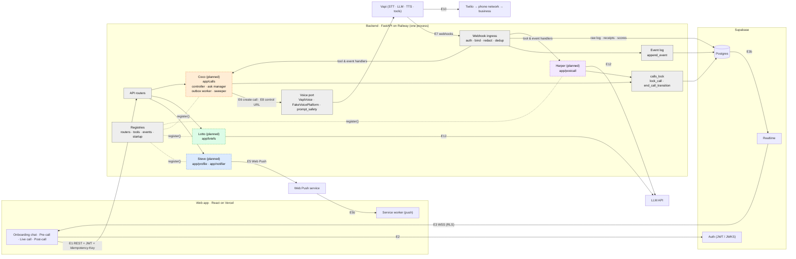
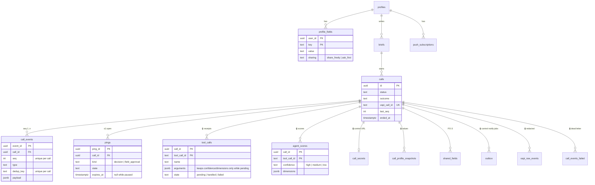
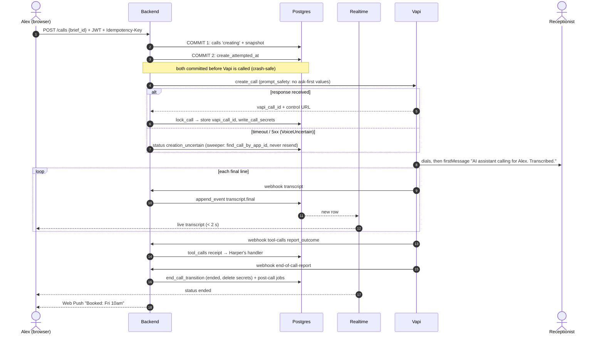
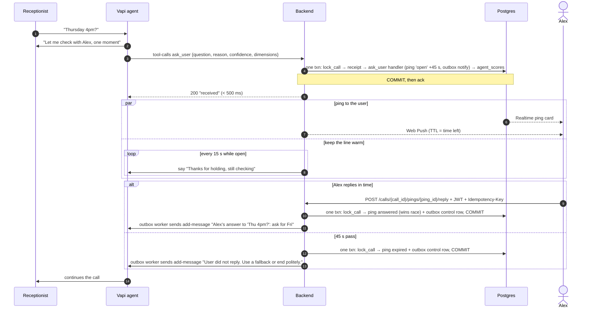
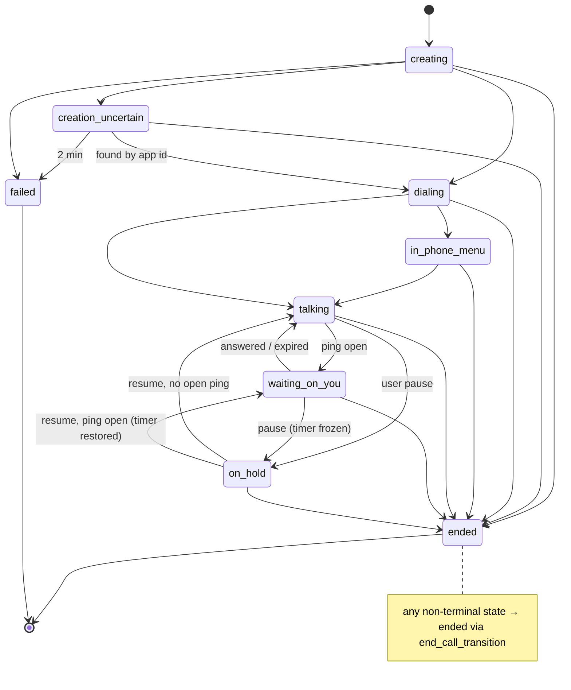
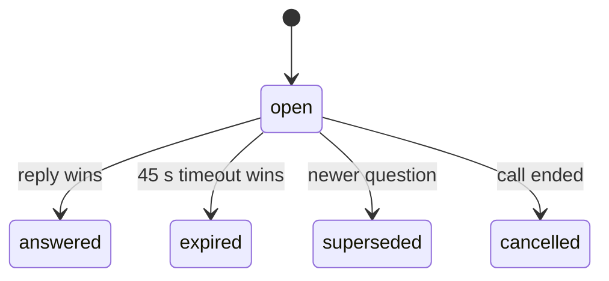
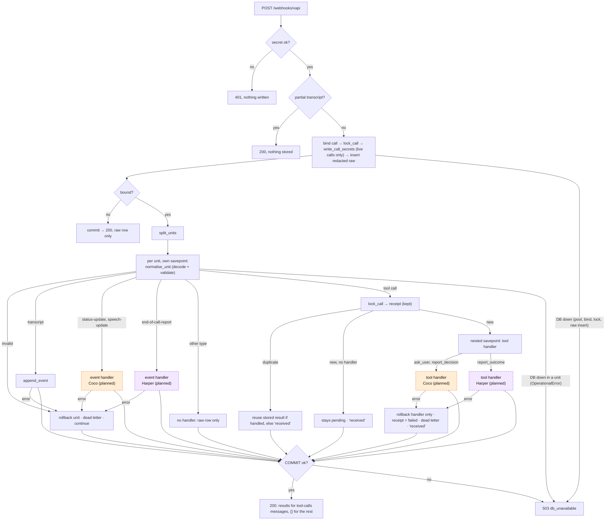

# System overview

A map of the whole system for teammates who have not read the [blueprint](architecture.md). It answers three questions: what the system does, how one call flows through it, and where your code plugs in. Details live in the [blueprint](architecture.md) and the [During-call tech doc](tech-doc-during-call.md); this page links to them instead of repeating them.

In one paragraph: the user (Alex) fills in a brief, the backend places a phone call through Vapi, and the AI agent talks to the business. When the agent is missing something it pauses, pings Alex for a one-tap reply (45 s), then continues the call. After the call, the outcome and a summary are saved.

Colours: **grey** = foundation, **blue** = Steve (onboarding), **green** = Lotto (pre-call), **orange** = Coco (during call), **purple** = Harper (post-call). Only three diagrams use colour: the big picture (section 1), the class diagram (section 2) and the webhook ingress flowchart (section 7). Wherever colour marks ownership, the owner's name is also in the node text.

**Status:** grey is built and tested. Blue, green, orange and purple are planned: those packages do not exist yet, and the diagrams show the intended design.

Contents: [1. Big picture](#1-the-big-picture) · [2. Inside the backend](#2-inside-the-backend) · [3. The data](#3-the-data) · [4. One call](#4-one-call-start-to-finish) · [5. Pause and ping](#5-pause-and-ping-the-critical-path) · [6. States](#6-states) · [7. Webhook ingress](#7-webhook-ingress) · [8. Glossary](#8-glossary-and-further-reading) · [Try it locally](#try-it-locally)

## 1. The big picture

Look for: who talks to whom, and over which edge (dashed boxes are planned) (`E1` to `E12` are the edge numbers from [blueprint section 1](architecture.md#1-system-overview-and-communication-topology)).

**Your part:** the ownership map from [`backend/README.md`](../backend/README.md#ownership-map), with the requirement IDs ([requirements.md](requirements.md)).

| Owner | Package | Requirements | Builds on |
| --- | --- | --- | --- |
| Steve | `app/profile/`, `app/notifier/` | ON-3, ON-5 to ON-8, Web Push | `profile_fields`, `push_subscriptions`, outbox `notify` lane |
| Lotto | `app/briefs/` | PC-1 to PC-7 | `briefs`, `create-call` contract |
| Coco | `app/calls/` (controller, ask manager, status machine, outbox worker, sweeper) | DC-* | voice port, `call_secrets`, `pings`, outbox `control` lane, the `ask_user`, `report_decision`, `status-update` and `speech-update` handlers |
| Harper | `app/postcall/` | PO-1 to PO-6 | the `report_outcome` and `end-of-call-report` handlers, `shared_fields`, outbox `jobs` lane |

The frontend is split by the same lines (onboarding, pre-call, live call, post-call).

## 2. Inside the backend

Look for: the interfaces each owner codes against. Foundation code is built; owners call it and register into it.

```mermaid
classDiagram
  class Registries {
    +add_router(router)
    +on_startup(fn)
    +tools: ToolRegistry
    +events: EventRegistry
  }
  class ToolRegistry {
    +register_tool_handler(name, fn)
    +get(name) ToolHandler?
    +names() list
  }
  class EventRegistry {
    +register_event_handler(vapi_type, fn)
    +get(vapi_type) EventHandler?
  }
  class ToolCallContext {
    +call_id: UUID
    +user_id: UUID
    +tool_call_id: str
    +name: str
    +arguments: dict
    +source_ts: datetime?
  }
  class WebhookIngress {
    <<module app/webhooks/vapi.py>>
    +dispatch_pending(pool, limit=50, *, tools) int
    +run_ingress_startup(pool, tools)
  }
  class WebhookNormalise {
    <<module app/webhooks/normalise.py>>
    +split_units(redacted_body) list
    +normalise_unit(unit, secrets)
  }
  class VoicePlatform {
    <<Protocol>>
    +create_call(assistant, customer_e164, metadata, snapshot) CreatedCall
    +get_call(vapi_call_id) dict
    +send_control(control_url, message)
    +find_call_by_app_id(call_id, created_after) CreatedCall?
  }
  class VapiVoice
  class FakeVoicePlatform
  class CreatedCall {
    +vapi_call_id: str
    +control_url: str?
    +listen_url: str?
  }
  class VoicePort {
    <<module app/voice/port.py>>
    +prepare_assistant(assistant, snapshot) dict
  }
  class PromptSafety {
    <<module app/voice/prompt_safety.py>>
    +resolve_task_vars(brief, snapshot) dict
    +assert_prompt_safe(text, snapshot)
    +build_first_message(brief, snapshot) str
  }
  class Snapshot {
    +fields: key to value and sharing
    +get(key)
  }
  class CallsLock {
    <<module app/calls_lock.py>>
    +lock_call(conn, call_id) CallRow
    +write_call_secrets(conn, call_id, control_url, listen_url) bool
    +end_call_transition(conn, call_id, reason, source) bool
  }
  class EventLog {
    <<module app/events.py>>
    +append_event(conn, call_id, type, source, payload, occurred_at, dedup_key) CallEvent?
  }
  class SecretRegistry {
    +add(value)
    +all() frozenset
    +add_settings(settings)
    +load_call_secrets(conn) int
  }
  class RedactingFormatter
  class CocoHandlers:::coco {
    <<planned app/calls, Coco>>
    ask_user and report_decision tool handlers
    status-update and speech-update event handlers
  }
  class HarperHandlers:::harper {
    <<planned app/postcall, Harper>>
    report_outcome tool handler
    end-of-call-report event handler
  }
  classDef coco fill:#ffedd5,stroke:#ea580c,color:#111111,stroke-dasharray:5 3
  classDef harper fill:#f3e8ff,stroke:#9333ea,color:#111111,stroke-dasharray:5 3
  VoicePlatform <|.. VapiVoice
  VoicePlatform <|.. FakeVoicePlatform
  VoicePlatform ..> CreatedCall
  VoicePlatform ..> VoicePort : create_call runs prepare_assistant
  VoicePort ..> PromptSafety : assert_prompt_safe
  PromptSafety ..> Snapshot
  Registries *-- ToolRegistry
  Registries *-- EventRegistry
  ToolRegistry ..> ToolCallContext
  WebhookIngress ..> ToolRegistry : dispatch_pending(tools=reg.tools)
  WebhookIngress ..> WebhookNormalise
  WebhookIngress ..> CallsLock
  WebhookIngress ..> EventLog
  CallsLock ..> SecretRegistry
  CallsLock ..> EventLog
  RedactingFormatter ..> SecretRegistry
  CocoHandlers ..> ToolRegistry : register(reg)
  CocoHandlers ..> EventRegistry : register(reg)
  HarperHandlers ..> ToolRegistry : register(reg)
  HarperHandlers ..> EventRegistry : register(reg)
```

**Your part:** Coco codes against `VoicePlatform`, `CallsLock` and the `ask_user` / `report_decision` / `status-update` / `speech-update` handlers. Harper codes against `report_outcome` and `end-of-call-report`. Steve and Lotto mostly add routers through `Registries.add_router`. Every owner package exposes `register(reg)`, which `create_app` finds automatically.

The four rules every owner follows:

- Lock the call first (`lock_call` before any ping or outbox write).
- Write events only through `append_event`.
- Never send a profile value without going through the snapshot.
- Change contracts additively, then run `make -C contracts gen`.

## 3. The data

Look for: tables, keys, and who can read each one. Legend: a lock marks backend-only tables (the browser has no access). Every other table is readable by its owner through RLS (row-level security). Only the backend writes billing and audit data.

Notes:

- `idempotency_keys` (backend-only) is keyed by user, not call, so the diagram leaves it out.
- `confidence` and `dimensions` live in `agent_scores`. They also appear in the redacted `vapi_raw_events` delivery log, and in `tool_calls.arguments` while the receipt is `pending`. They are stripped from the receipt once it is `handled` or `failed`, and handlers never see them.
- Browser-readable: `profiles`, `profile_fields`, `briefs`, `push_subscriptions` (select and delete), `calls`, `call_events`, `pings` and `shared_fields`. Everything else is backend-only.
- The schema lives only in `supabase/migrations/`.

**Your part (planned):** Steve builds on `profile_fields` and `push_subscriptions`; Lotto on `briefs`; Coco on `pings` and the status in `calls`; Harper on `shared_fields` and `calls.outcome` (as in the ownership map above). The foundation owns `profiles` (created at first sign-in by `app/routers/me.py`), `call_events`, `tool_calls`, `agent_scores`, `call_secrets`, `call_profile_snapshots`, `outbox`, `vapi_raw_events` and `call_events_failed`.

## 4. One call, start to finish

Look for: what is committed before anything is sent, and where Realtime and Web Push take over.

**Your part (planned):** Lotto owns the brief behind `POST /calls`. Coco owns call creation and the uncertain-creation branch. The foundation runs the transcript loop. Harper owns `report_outcome` and the end-of-call jobs, and Steve sends the push.

## 5. Pause and ping, the critical path

Look for: everything that happens inside one transaction before the 200, and the race between Alex's reply and the 45 s timeout (exactly one wins).

**Your part (planned):** Coco owns the ask manager, the reply and timeout race, and the fillers. Steve owns Web Push. The foundation provides the receipt, the locking, the score storage and the registry. See [blueprint section 6](architecture.md#6-pause-and-ping-sequence-the-critical-path).

## 6. States

Look for: the only ways a call and a ping change state.

Call status (DC-14):

**Your part (planned):** Coco owns the state machine. `end_call_transition` is the only way into `ended`. Both `ended` and `failed` are terminal: it changes nothing for a call that is already in either, so a late `status-update` cannot revive a call.

Ping state:

**Your part (planned):** Coco owns ping transitions. A call has at most one `open` ping (a partial unique index enforces it).

## 7. Webhook ingress

Look for: what has already happened by the time your handler runs. The code is `app/webhooks/vapi.py`; the order below matches it.

Notes: a body that is not JSON, or has no `message`, is a 400 before anything else. A tool with no registered handler is stored `pending` and answered `"received"`; `dispatch_pending` runs it later. Unit errors are dead-lettered and the delivery is still acknowledged; only database failures give a 503 (`retryable`), so Vapi may retry.

**Your part (planned):** you write the coloured box labelled "event handler" or "tool handler" (Coco: `ask_user`, `report_decision`, `status-update`, `speech-update`; Harper: `report_outcome`, `end-of-call-report`). You run inside the transaction with the call lock held, so do not commit and do not call the network.

## 8. Glossary and further reading

- **Ping:** a question to the user mid-call (`pings` row), with a 45 s timer. At most one is open per call.
- **Brief:** the user's request for one call (who to call, what to do), written in the pre-call flow (`briefs`).
- **Snapshot:** the copy of the user's profile taken when a call starts (`call_profile_snapshots`). The call only ever sees the snapshot.
- **Ask-first:** a profile value the agent must not say until the user approves it in a ping. It never goes into the prompt. `share_freely` values may.
- **Outbox lane:** a queue inside the `outbox` table: `control` (commands to the live call), `notify` (pushes) and `jobs` (post-call work).
- **Control URL:** the per-call Vapi URL used to send live commands. It is a secret: stored in `call_secrets`, deleted when the call ends, redacted from logs.
- **Receipt:** the `tool_calls` row written for each Vapi tool call before its handler runs. A redelivery reuses it and never reruns the handler.

Further reading:

- [Architecture blueprint](architecture.md): [components](architecture.md#1-system-overview-and-communication-topology), [contracts](architecture.md#3-interface-contracts-and-data-formats), [delivery and failure rules](architecture.md#4-message-delivery-idempotency-and-failure-semantics), [pause-and-ping](architecture.md#6-pause-and-ping-sequence-the-critical-path)
- [During-call tech doc](tech-doc-during-call.md)
- [Requirements and IDs](requirements.md) (`ON-`, `PC-`, `DC-`, `PO-`)
- [Backend README](../backend/README.md): patterns by example, lock order, ingress and registries
- [CONTRIBUTING.md](../CONTRIBUTING.md) and [devops.md](devops.md): workflow and CI

## Try it locally

The dev tools (a seeded fake user, a recorded Vapi conversation replayed into the webhook, and a Realtime check) are `make -C backend seed-dev`, `make -C backend replay FIXTURE=… CALL_ID=…` and `make -C backend realtime-smoke`. Setup and what each one proves are in [backend/README.md](../backend/README.md#run-it-locally).
