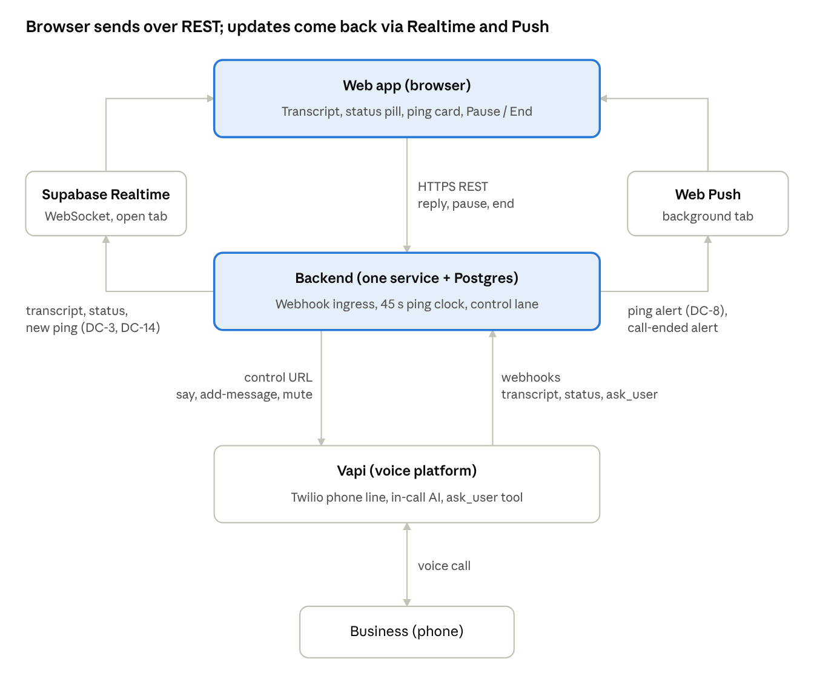
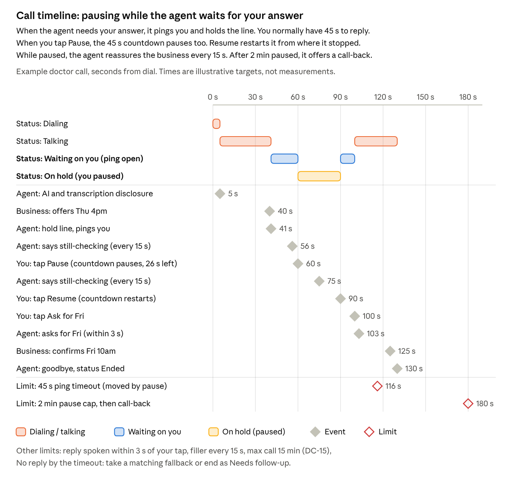

# During-call tech doc

**Owner:** Coco · **Updated:** 2026-11-06 · **Status:** Draft, Part 5 to confirm with Hung Lin (Steve)

Technical design for the P0 "During call" requirements Coco owns in [docs/requirements.md](requirements.md). It builds on the [architecture blueprint](architecture.md). The working copy is the [Claude doc](https://claude.ai/artifact/A8kcNjVnMkm84tqRyp3LqR), and this file is a snapshot of it.

## Requirements traceability

The browser only ever calls the backend, over REST. Only the backend talks to Vapi. Live updates come back through Supabase Realtime (open tab) and Web Push (background tab).

The ping clock only runs while the status is Waiting on you. Pausing moves the 45 s timeout from 86 s to 116 s, and the 2 min pause cap is the backstop.

| ID | Requirement | Technical design |
|---|---|---|
| DC-1 | Opening disclosure | Fixed `firstMessage` template, not model output: `Hi, I'm an AI assistant calling on behalf of {calling_name}. This call is transcribed. {task_line}` Task lines: Restaurant "I'd like to book a table for {party_size} on {day} at {time}." Doctor "I'd like to book an appointment with {provider_name}." Custom "I'm calling to {goal_summary}." (≤15 words) Only share-freely fields and the reviewed brief. A missing variable blocks Start. Recording is forced off. A test pins both. |
| DC-3 | Live transcript | Vapi `transcript` webhook → `call_events` → Supabase Realtime, one private channel per call. Partials go out as broadcast only (words mid-sentence, shown live and never stored). Final lines are stored. |
| DC-4 | Confidence-driven decisions | How the AI on the call decides whether to act on its own or ask you: for every offer or question from the business, it answers 6 questions. **Always ask you (2 gates):** Does it need an Ask-me-first field? Does it involve money, a deposit, a fee or a never-agree item? If either answer is yes, it pings you, whatever else is true. **Otherwise, 4 checks:** Does the offer meet every hard constraint? Does it match a fallback? Can it answer without making anything up? Did it understand what they said? **Result:** **High** • it acts on its own. • That happens when the offer meets the constraints or matches a fallback, it can answer from the brief, and it understood. **Medium** • every check passes but a preference is missed, it acts and flags it in the live feed • Example: you asked for a table for 6 at 7pm and would like a window seat. They have 7pm, but only on the patio. The constraints are met, so it books, and the feed shows "Booked 7pm. No window seat, patio only." **Low** • it pings you. • That happens when a constraint is broken and no fallback matches, or info is missing. If it didn't understand, it first asks the business to repeat, once. It re-checks every counter-offer. **Examples** (brief: doctor, before 3pm, fallback Fri morning): • "Thu 2pm?" Meets the constraint → High, books it. • "Fri 10am?" Breaks the first choice but matches the fallback → High, books it. • "Thu 4pm?" Breaks the constraint, no fallback → Low, pings "They offered Thu 4pm. You said before 3pm." • "New or existing patient?" Not in the brief → Low, pings. • "What's your date of birth?" Ask-me-first field → gate, pings. • "There's a $25 deposit." Money → gate, pings. **Logging:** High and Medium call `report_decision` (Medium also flags the miss in the feed). Low calls `ask_user`. All send the 6 answers in a `dimensions` object, which is logged for debugging and never shown to you. |
| DC-6 | Ask-first fields always ping | Ask-first values are never in the prompt. The server turns `field_requested` into a `field_approval` ping with fixed Share / Don't share replies. |
| DC-7 | Pause and ping, keep the line open | `ask_user` is async. The model says the hold line, then stays silent. When the AI asks you something, our server does three things and saves them together: • it logs the question • starts your 45-second reply clock • queues the notification to you plus the "still checking" lines to the business. • Then it tells Vapi "got it" in under half a second, so the call never stalls waiting on us. • Saving them together (one database transaction) means a crash can't leave a half-opened ping. While you decide, the agent tells the business "Thanks for holding, still checking with Alex" every 15 s, so they don't hang up. • Each line is sent once and never repeated. • If you've already replied, the line is skipped. • If the business changes its offer mid-wait ("actually, Friday works"), the new question replaces the old one on your screen, so you only ever see one question at a time. |
| DC-8 | Ping delivery and reply | Card via Realtime within 1 s. Web Push reaches a background tab (`TTL` = time left, `tag` = ping_id). A click focuses the tab and re-reads the ping state. Your tap and the 45 s timeout can land at almost the same moment. The server lets only one count: whichever reaches the database first while the clock is still running. If you tap at 45.2 s, the timeout has already won, and the card says "too late" so the agent never hears two answers. The winning answer goes to the agent along with the question it answers ("Alex's answer to 'Thu 4pm?': ask for Fri"), so it can't be applied to the wrong question. **Target: the agent speaks it within 3 s.** Free text: trimmed, capped at 200 chars, control chars stripped, then sent as `Alex's answer to "<question>": <text>`. No extra LLM call, and free text never releases an ask-first value. |
| DC-9 | No reply in time | Timeout injects "user did not reply". The model takes a matching fallback or ends politely. The outcome becomes Needs follow-up. |
| DC-11 | Pause agent / end call | Pause: the agent speaks a fixed hold line we send ("One moment please"), using `say`, Vapi's command for speaking an exact sentence word for word. It goes silent after 0.7 s of quiet, or after 4 s at most, so it never cuts itself off mid-word. While paused, the 45 s ping clock freezes and resumes where it left off. A reassurance line plays every 15 s. Proposed: after 2 min paused, the agent offers a call-back and ends as Needs follow-up. End: goodbye `say` with `endCallAfterSpoken`, then `end-call` after 6 s. |
| DC-14 | Call status | Server state machine. • Dialing ← Vapi queued or ringing. • Talking ← Vapi in-progress, with no ping and no pause. • Waiting on you ← ping open. • On hold ← user pause. • Ended ← end-of-call report, and final. Unknown states show as "Unknown" and never crash the UI. |

## Part 5: System architecture, to confirm with Hung Lin (Steve)

This doc assumes the blueprint as written: one backend service, Postgres as the event log, JSON over HTTPS on every edge, Supabase Realtime plus Web Push for pings, and Vapi behind an adapter (Retell if probe 3 fails). The eight questions below need Steve's answer before build week starts on Nov 9.

| # | Question for Steve | Why it matters | Affects | Proposed answer |
|---|---|---|---|---|
| 3 | Will onboarding add the always-shared **calling name** field? | DC-1 needs a name in the opening line, but ON-5 lets any field be Ask me first | DC-1, ON-3, ON-5 | **Coco's call: yes.** Calling name is a required, always-shared field. It can never be Ask me first. It defaults to the full name and can be edited. PRD ON-3 and ON-5 are updated to match. |
| 4 | How does the live transcript get from the backend to the browser? Default: Supabase Realtime pushes each new database row to the open tab ("Postgres Changes"). Backups if that lags: the backend pushes lines itself over Realtime ("broadcast"), or keeps its own open connection to the tab ("SSE"). | DC-3's 2 s budget is unmeasured | DC-3 | No separate spike. This isn't a production metric, just the PRD's "feels live" bar for the demo. Use Supabase Realtime and watch the first test call. Switch only if the transcript visibly lags |
| 5 | Will the probe kit add `confidence`, `field_requested`, `report_decision` and `report_outcome` before the live session? | The probe kit's `ask_user` lacks them, so probe results may not carry over | DC-4, DC-6 | Add them to the probe kit before the session |
| 6 | Can we run the Vapi test calls before build week (Nov 9)? Is the Twilio number live in Vapi? | Every latency number in this doc is a target until then | All |  |
| 7 | Backend language, framework and host? The blueprint leaves these to the tech doc. | Needed before the first backend PR | All | **Host: Railway** (Coco sets it up). Language and framework still to confirm with Steve. Suggested: Python + FastAPI, so the probe kit's Vapi code can be reused. The frontend stays on Vercel. |
| 8 | The PRD says Pause takes effect within 2 s. But if you tap Pause while the agent is mid-sentence, it finishes the sentence first so it doesn't cut off mid-word, which can take up to 4 s. Is that OK for the demo? | It may miss the PRD target | DC-11 | **Coco's call: OK for the demo.** |

## Build decisions (backend, app/calls)

Decisions made while building the backend for Pause / Resume / End (DC-11) and the agent prompt (DC-4). Decided by Coco on 2026-11-10 unless noted.

| # | Question | Decision | Status |
|---|---|---|---|
| 1 | The user answers a ping while the call is paused. Send the answer to the agent at once, or wait? | **Wait until Resume.** Pause means the agent stays quiet. Resume unmutes first, then sends the held answer. This differs from architecture §4.1 ("a reply while paused queues unmute first, then the reply"). | Decided |
| 2 | Can Vapi speak a `say` while the assistant is muted? The pause reassurance unmutes, says the line, then mutes again. | Keep unmute, say, mute until the Vapi session shows whether `say` works while muted. | **Pending: Vapi probe 6** |
| 3 | When does the mute go out after the hold line? | **Steve's quiet rule** (architecture §4.1): after the hold line is sent, mute once the assistant has been silent for 0.7 s after an assistant `stopped` event. An assistant `started` waits for the next stop. 4 s is the latest. | Decided |
| 4 | The pause cap ends the call as Needs follow-up. Who writes `calls.outcome`? | The backend does not write the outcome for now. The call still ends with a call-back offer, and the feed shows why. | **Pending: Harper (post-call)** |
| 5 | `instruction` commands (DC-10) arrive at the same `/commands` endpoint. | The endpoint answers `422 unsupported_command` until Lotto's handler lands. | **Pending: Lotto (DC-10)** |
| 6 | The agent's prompt needs guardrail rules (DC-13: never claim to be human, no payments without a ping, refused-AI handling), which are Lotto's. | Use the probe kit's reviewed rules as a placeholder (`GUARDRAIL_RULES` in `app/calls/prompt.py`), to be replaced wholesale by Lotto's. | **Pending: Lotto (DC-13)** |
| 7 | Which model, voice and transcriber does the agent use? | The probe kit's: `gpt-5.4-mini`, Vapi "Clara", Deepgram nova-3. | **Pending: Vapi session** |

## Risks and next steps

The biggest risk is unchanged: no one has checked whether a real receptionist will hold for 45 s.

| Risk | Fallback |
|---|---|
| Vapi fails probe 3 | Rerun the probes on Retell. Only the voice-platform adapter changes |
| The model skips `ask_user` on a money or ask-first question | Ask-first values are never in the prompt. A post-call check flags any unpinged `accept` that mentions money as a guardrail breach |
| Push is missed in a background tab | The in-app card is the source of truth. A missed ping falls to the DC-9 timeout path |

- [ ] Review the Part 5 questions with Steve and record his answers in the table
- [ ] Share the calling-name field and the three-tier rubric with Lotto, then update the PRD in Notion
- [ ] Fill in latency targets from `spikes/vapi/RESULTS.md` after the Vapi session
